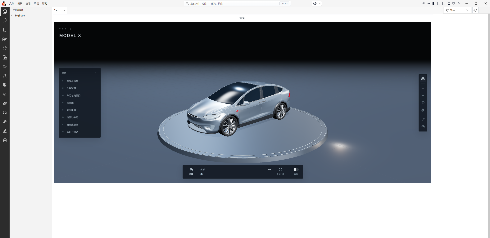
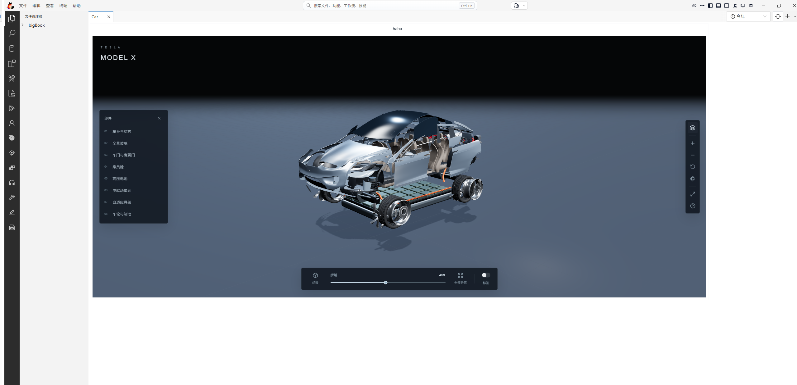

# Model X Studio

Interactive 3D Tesla Model X studio with a circular display platform, component descriptions, individual-piece isolation, and a progressive explosion slider covering all 334 mesh pieces.

## Model source and scope

The Model X asset is by [cgi Moon on BlendKit](https://www.blendkit.com/asset-gallery-detail/983e8f94-5a56-44a4-94d9-eed5e4cdcd6c/), used under the [BlendKit Royalty Free license](https://www.blendkit.com/docs/licenses/). Asset redistribution is subject to that license; this repository is private and the asset is embedded in the application.

This source depicts a pre-refresh Model X, with an unverified exact model year. The 334 pieces are artist-authored mesh islands, not verified Tesla service-part identifiers. Battery, drive units and suspension are illustrative geometry. This is an independent educational project, not a complete OEM parts catalog or a Tesla-affiliated product.
